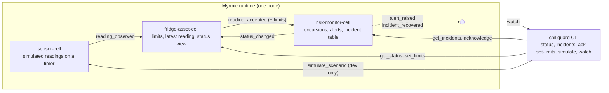

# ChillGuard

Cold-storage risk monitor on [Myrmic](https://book.myrmic.dev/). ChillGuard
watches a refrigerator's temperature, measures how long it stays outside a
configured safe range, raises a warning when it leaves the range and a
critical alert when the excursion has lasted long enough, records the
recovery, and keeps the incident history. Version 0.1.0 monitors one
simulated refrigerator on one Myrmic node and is operated from a command
line; see [CHANGELOG.md](CHANGELOG.md).

Built and tested against Myrmic 0.7.0 (developer preview), Linux x86_64.

> **Safety disclaimer.** ChillGuard records temperature observations and
> reports what it observed. It does not, and cannot, say that food, medicine
> or anything else stored in a refrigerator is safe. A recovered incident
> means the measured temperature came back into range, nothing more. The
> readings in this version come from a simulator, not a sensor. Decisions
> about stored goods are the responsibility of the people and procedures at
> the site, and ChillGuard is not a substitute for a certified monitoring
> system where one is required.

## How it works

Three Myrmic cells, each a small WebAssembly module, share the work of one
refrigerator. The rules live in one plain Rust crate that the cells call;
the cells only decode, call, persist and publish (docs/decisions/0001).



- **sensor-cell** plays a deterministic thermal model (normal day, power
  failure, door open) and publishes a timestamped reading every interval.
- **fridge-asset-cell** owns the refrigerator's limits and its latest
  accepted reading. It applies the acceptance rule (right refrigerator,
  finite value, later than the last one) and forwards each accepted reading
  with the limits in force.
- **risk-monitor-cell** runs the state machine: `normal`, `warning`,
  `critical`, `sensor_stale`. It raises each alert once per incident, keeps
  one open incident at a time, declares the sensor stale from a timer, and
  stores every incident in a table.
- **chillguard** is a native CLI that reaches the cells through the Myrmic
  CLI. It shows status and incidents, acknowledges incidents, changes
  limits and, in development deployments, drives the simulator.

The state machine, how exposure is measured across gaps, what a restart
does and every other edge are written down in
[docs/decisions/0003-risk-policies.md](docs/decisions/0003-risk-policies.md).
The full proposal, including the two-node picture that is not built yet, is
[docs/architecture.md](docs/architecture.md).

## Prerequisites

| What | Why | How |
|---|---|---|
| Linux x86_64 | The Myrmic CLI is released as an x86_64 package. | |
| [rustup](https://rustup.rs/) | The workspace pins `nightly-2026-08-07` in `rust-toolchain.toml`; rustup installs it, with the Wasm target, on the first `cargo` command. | `curl --proto '=https' --tlsv1.2 -sSf https://sh.rustup.rs \| sh` |
| A C toolchain | Build scripts of dependencies compile natively. | `sudo apt install build-essential` |
| Myrmic CLI 0.7.0 | Builds the cells to Wasm, runs the runtime, deploys, and is the transport the operator CLI uses. Needs glibc 2.39 or newer (Ubuntu 24.04, Debian 13). | See below |
| `python3`, `make` | The end-to-end harness reads JSON with Python; `make` drives everything. | usually present |
| `cargo-deny`, `cargo-llvm-cov` (optional) | Licence and advisory check, coverage gate. CI installs its own. | `cargo install cargo-deny cargo-llvm-cov` |

Install the Myrmic CLI from the release package and verify it, as its
[installation page](https://book.myrmic.dev/docs/quickstart/installation)
describes:

```sh
version=0.7.0
base="https://github.com/peeriot/myrmic/releases/download/myrmic/v$version"
curl -fLO "$base/SHA256SUMS"
curl -fLO "$base/myrmic-cli_${version}_amd64.deb"
sha256sum --ignore-missing -c SHA256SUMS
sudo apt install "./myrmic-cli_${version}_amd64.deb"
myrmic --version        # 0.7.0
```

## Setup

```sh
git clone https://github.com/Weebad123/chillguard.git
cd chillguard
make lint test          # clippy with warnings as errors, then the host tests (about 2 minutes cold)
make build-cells        # the three cells, to target/wasm32-unknown-unknown/release/*.wasm
make cli                # the operator CLI, to target/debug/chillguard
export PATH="$PWD/target/debug:$PATH"
```

`make help` lists every target. `make ci` runs the same gates as the GitHub
workflow, which needs `cargo-deny` and `cargo-llvm-cov` installed.

## Run

Start a runtime that only this host can reach, tell every tool where it is,
and deploy the cells with the production payloads:

```sh
myrmic runtimes start config/runtime.local.yml --name chillguard --detached
export MYRMIC_CONNECT=tcp/127.0.0.1:20123
make deploy             # PROFILE=prod: real-time sensor, 10 s interval, dev commands refused
chillguard status
```

```text
refrigerator  fridge-1
status        normal
last reading  4.1 °C at 2026-10-11T12:52:30Z (3s before this snapshot)
limits        2.0 to 8.0 °C, hysteresis 0.5 °C
critical      after 30m out of range
stale         after 5m without a reading
incident      none
snapshot      2026-10-11T12:52:33Z
```

What else you can do while it runs:

```sh
chillguard watch                              # status changes, alerts, recoveries as they happen
chillguard incidents --limit 20               # newest incidents first
chillguard set-limits --upper 10 --critical-after 45m
chillguard ack <incident id>                  # record that someone has seen it
myrmic runtimes chillguard logs | grep wasm_log   # what the cells logged
```

The limits, the readings and the incidents are in the runtime's database
and survive a runtime restart; the cells themselves do not. After
`myrmic runtimes delete chillguard` and a new `runtimes start`, run
`make deploy` again with the same `PROFILE` and the cells carry on from
their stored state (see [Limitations](#limitations)).

[docs/operations.md](docs/operations.md) covers every command and option,
the log lines, telemetry, and what to do when something looks wrong.
[config/README.md](config/README.md) describes the runtime configuration
and the deployment profiles. [docs/security.md](docs/security.md) says who
can reach what and how to limit it.

## Demo: a power failure

The `dev` profile plays the simulator sixty times faster than the clock and
shortens the durations (critical after 60 s, stale after 30 s), so a
two-hour power failure takes about three minutes. It also turns on
`dev_mode`, which is what lets `chillguard simulate` drive the sensor. With
the runtime from [Run](#run):

```sh
make deploy PROFILE=dev
chillguard simulate power_failure_2h --seed 3
chillguard watch --for 4m
```

The scenario: 30 minutes of normal operation, then the power fails and the
cabinet warms toward the room, then power returns and it cools back down.
At 60x that is 30 s normal, a crossing of the 8 °C limit about a minute
later, critical a minute after that, and recovery a few seconds after the
power returns at 2 min 30 s.

What a run looked like on 2026-10-11 (`--seed 3`; the noise and so the
exact temperatures depend on the seed):

```text
$ chillguard watch --for 4m
watching fridge-1: status normal, last reading 3.8 °C, limits 2.0 to 8.0 °C, hysteresis 0.5 °C (Ctrl-C to stop)
2026-10-11T12:53:26Z  status     normal -> warning
2026-10-11T12:53:26Z  ALERT      warning   fridge-1-1791723206960  out of range at 8.2 °C
2026-10-11T12:54:27Z  ALERT      critical  fridge-1-1791723206960  out of range for 1m, 8.1 to 11.2 °C
2026-10-11T12:54:27Z  status     warning -> critical
2026-10-11T12:54:41Z  recovered  fridge-1-1791723206960  was critical, out of range for 1m 13s, now 7.3 °C
2026-10-11T12:54:41Z  status     critical -> normal

$ chillguard incidents
INCIDENT                SEVERITY  STARTED               RECOVERED             EXPOSURE  RANGE           GAP  ACKNOWLEDGED
fridge-1-1791723206960  critical  2026-10-11T12:53:26Z  2026-10-11T12:54:41Z  1m 13s    7.8 to 11.2 °C  no   no

1 incident for fridge-1 as of 2026-10-11T12:55:16Z

$ chillguard ack fridge-1-1791723206960
incident fridge-1-1791723206960 acknowledged at 2026-10-11T12:55:16Z
```

Reading the output: the warning was raised on the first reading above
8 °C; the critical alert one minute of exposure later, while the cabinet was
still warming (11.2 °C at the peak); the recovery when a reading fell to
7.5 °C or below, the limit less the hysteresis. The incident keeps
`critical` after it recovered. `EXPOSURE` is the time between the first and
the last out-of-range reading; `GAP` would say `yes` if readings had been
missing for longer than `stale_after` in between. Add `--json` to any
command for the same information as one JSON document.

`chillguard status` afterwards shows `status normal` and `incident none`
again.

Other presets: `short_door_open` (five minutes with the door open, a
warning and a critical at these limits) and `normal_day`. Under the `prod`
profile `simulate` is refused and the sensor logs
`simulate_scenario rejected ... reason=dev_mode_off`.

**Restart drill.** While an incident is open:

```sh
myrmic runtimes delete chillguard
myrmic runtimes start config/runtime.local.yml --name chillguard --detached
make deploy PROFILE=dev
chillguard status
```

The monitor logs `risk-monitor-cell started ... resumed=true status=critical
incident_id=<the same id>`, no alert is raised a second time, the incident's
exposure includes the outage and `has_data_gap` is set. This is the
`restart` scenario of the end-to-end suite.

## Testing

| Command | What it runs | Time |
|---|---|---|
| `make test` | Host tests: 64 unit tests of the risk rules and the transition table, property tests, scenario tests for normal, warming, critical, recovery, sensor dropout and restart, the simulator, the wire contract (round trips, malformed input, golden files) and the CLI (arguments, rendering snapshots, a fake `myrmic`). | seconds |
| `make lint`, `make fmt-check`, `make doc` | Clippy with warnings as errors under the workspace lint set (no `unwrap`, `expect`, `panic!`, indexing or `unsafe` outside tests and the handler exports), formatting, rustdoc. | 1 min cold |
| `make build-cells` | Every cell to Wasm with `myrmic build`. The check that core and protocol stayed `no_std`. | 1 min cold |
| `make deny` | cargo-deny: licences and RustSec advisories ([deny.toml](deny.toml)). | seconds |
| `make coverage` | Every host test under cargo-llvm-cov; fails if `chillguard-core` is below 90 % of lines. It is at 100 %. | 2 min |
| `make e2e` | `scripts/e2e.sh`: a throwaway loopback-only runtime, the three cells, four scenarios (normal, excursion, stale, restart) driven and checked through the operator CLI, with the cell logs as evidence. | 5 min |

[docs/acceptance.md](docs/acceptance.md) maps each acceptance criterion to
the tests that cover it. The GitHub workflow
([.github/workflows/ci.yml](.github/workflows/ci.yml)) runs everything but
`e2e` on every push and pull request; `e2e` is a manual job.

## Project layout

```text
Cargo.toml                 workspace: one toolchain, one lint set, shared dependencies
crates/
  chillguard-core/         the rules: risk state machine, asset state, simulator (no_std, no I/O, no clock)
  chillguard-protocol/     every message on the wire, with its validation and golden files
  chillguard-cli/          the `chillguard` operator CLI
  cells/
    sensor-cell/           Myrmic cell: readings on a timer, `simulate_scenario` in dev mode
    fridge-asset-cell/     Myrmic cell: limits, latest reading, status view, `get_status`, `set_limits`
    risk-monitor-cell/     Myrmic cell: evaluation, alerts, incident table, `get_incidents`, `acknowledge`
config/                    runtime configurations and the prod, dev and e2e deployment payloads
scripts/                   deploy.sh, e2e.sh, cells.sh
docs/
  architecture.md          the proposal and the acceptance criteria
  acceptance.md            criteria mapped to code and tests
  security.md              threat model, validation, access limits, known gaps
  operations.md            the CLI, logs, telemetry, troubleshooting
  myrmic-notes.md          what was verified about Myrmic 0.7.0, with sources
  decisions/               0001 core vs cells, 0002 toolchain, 0003 risk policies, 0004 wire contract, 0005 state ownership
.github/workflows/ci.yml   the quality gates
deny.toml                  licence and advisory policy
```

## Limitations

What was verified, by `make e2e` and the experiments recorded in
[docs/myrmic-notes.md](docs/myrmic-notes.md) (sections 10 to 13), and what
is known to be missing.

**Persistence and recovery, as verified on Myrmic 0.7.0**

- A cell's state (limits, latest reading, status view, monitor state,
  simulator position) and the incident table survive a runtime stop by
  SIGTERM, by `kill -9`, and a delete-and-redeploy of the cell under the
  same name, when the runtime has a persistent database (not `--tmp`).
- After a runtime restart the cells are gone and are not restarted by the
  runtime, whatever `--policy` says. They must be deployed again; their
  state is found and used (`resumed=true` in the start lines). Limits
  changed with `set-limits` win over the init payload.
- An open incident survives a restart as the same incident: no second
  warning or critical alert, exposure continues to accrue from the reading
  timestamps, and an outage longer than `stale_after` is recorded as a data
  gap on the incident.
- Readings that would have been taken while the runtime was down are lost.
  Exposure counts that silence in full, as a gap, by policy.
- Timers die with the cell. The sensor's interval and the monitor's stale
  tick are re-armed on deploy; between the restart and the redeploy nobody
  measures and nobody can declare the sensor stale.
- State is held as one copy on one node. Losing the node's disk loses it.
  Replication exists in Myrmic and has not been configured or tested here.
- The e2e restart drill keeps the runtime down for about 15 s. Longer
  outages have not been staged.

**Known gaps**

- One refrigerator per deployment, one node. The second refrigerator and
  the second node of the architecture are not built.
- No web dashboard and no notifications; the CLI and the logs are the
  interface.
- No physical sensor. The sensor cell plays a model.
- No authentication inside the swarm. Anyone who can reach the runtime's
  network can publish readings, change limits or acknowledge incidents.
  Access is limited at the network boundary and, optionally, with mutual
  TLS between nodes; see [docs/security.md](docs/security.md).
- The asset cell's status is an event-fed view and can miss a change
  (docs/decisions/0005). `chillguard status` shows the monitor's incident
  beside it and a note when the two disagree; `get_status` alone cannot
  tell.
- A reading with a timestamp far in the future makes every later reading
  `out_of_order` until real time catches up; nothing detects a stepped
  clock (policy 3 in docs/decisions/0003).
- The incident table and the optional time-series history grow without
  bound; `get_incidents` returns at most the newest 100 and there is no
  paging or expiry.
- Events travel the whole network. Two deployments that name the same
  refrigerator feed each other's readings; give each its own
  `refrigerator_id` and `SRN_PREFIX`.
- `State::load()` was twice seen to return nothing for a few seconds while
  other runtimes were on the network, cause unknown (docs/myrmic-notes.md,
  section 13). The loopback-only runtime configuration avoids the
  conditions; it is not a fix.
- The end-to-end suite runs on developer machines; it is a manual job in
  CI and has not been run on a hosted runner yet.
- Mutual TLS is documented from Myrmic's security page and has not been
  exercised in this project.

## Licence

No licence has been chosen yet; until one is added the code is all rights
reserved. Dependencies are limited to permissive licences by `deny.toml`.
