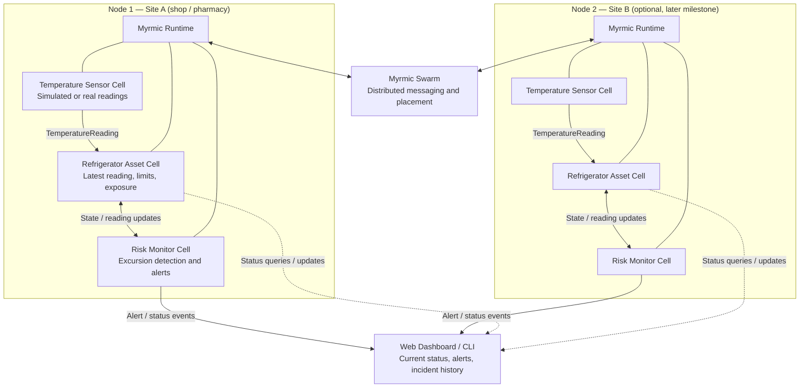
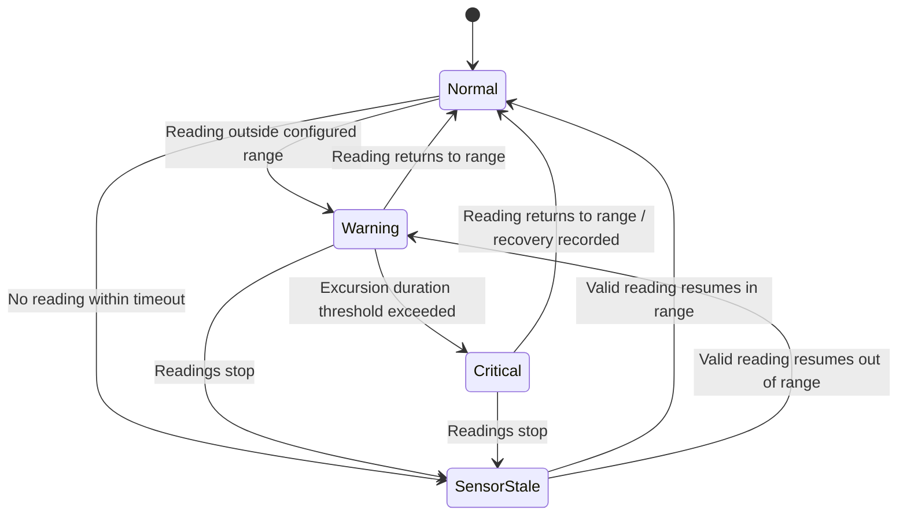

# ChillGuard — Myrmic Cold-Storage Risk Monitor

## 1. Project overview

**ChillGuard** is a lightweight cold-storage monitoring application that tracks refrigerator temperatures, measures how long readings remain outside a configured safe range, and raises actionable alerts.

The initial MVP uses simulated temperature readings, so it can be developed and demonstrated without physical sensors. Real sensor integration can be added later.

**Core goals**
- Monitor current refrigerator temperature.
- Track temperature-excursion duration.
- Generate alerts when configurable thresholds are exceeded.
- Preserve incident and recovery history.
- Provide a simple dashboard or CLI for status and testing.
- Use Myrmic's Cells, messaging, state management, and runtime capabilities where supported by the installed version.


## 2. High-level architecture



**Build order:** start with Node 1 and one refrigerator. Add the second node only after the first node's state updates and alerts work reliably.

## 3. Cell responsibilities

### Temperature Sensor Cell
- Produces timestamped temperature readings at a configurable interval.
- Initially simulates normal operation, warming after a power failure, and cooling after recovery.
- Later can receive readings from a physical sensor.
- Suggested reading fields:
  - `refrigerator_id`
  - `temperature_c`
  - `observed_at`
  - `source` (`simulated` or `sensor`)

### Refrigerator Asset Cell
- Owns the refrigerator's current state and configuration.
- Stores the latest temperature and reading timestamp.
- Stores configured upper/lower limits and exposure-tracking state.
- Makes status available to other application components.
- Suggested state:
  - `refrigerator_id`
  - `temperature_c`
  - `last_reading_at`
  - `lower_limit_c` (optional)
  - `upper_limit_c`
  - `out_of_range_since`
  - `exposure_duration_seconds`
  - `current_status`

### Risk Monitor Cell
- Evaluates readings against the refrigerator's configured limits.
- Tracks the duration of an excursion using timestamps and elapsed time, not merely the number of readings.
- Raises a warning when the temperature leaves the configured range.
- Escalates to a critical alert if the configured duration threshold is exceeded.
- Avoids duplicate alerts for the same active incident.
- Records recovery when readings return to the configured range.
- Suggested statuses: `normal`, `warning`, `critical`, `sensor_stale`.

### Dashboard / CLI
- Displays each refrigerator's latest reading, status, and exposure duration.
- Shows active alerts and incident/recovery history.
- Provides development controls to simulate power failure, recovery, or temperature changes.
- For the earliest MVP, a CLI and structured logs are sufficient; a web dashboard can follow.

## 4. Key data flows

1. **Reading:** Sensor Cell sends a timestamped temperature reading to the Refrigerator Asset Cell.
2. **State update:** Asset Cell validates and updates its current state.
3. **Risk evaluation:** Risk Monitor evaluates the new reading and elapsed time outside the configured range.
4. **Alert:** Risk Monitor emits a warning, critical alert, or recovery event when appropriate.
5. **Presentation:** Dashboard or CLI reads state and displays current status and incident history.
6. **Optional distribution:** Multiple nodes exchange messages through the Myrmic runtime's supported distributed messaging mechanisms.

The arrows describe intended application behavior. Confirm the exact handler, message, and query APIs against the installed Myrmic SDK; do not assume these are built-in APIs with these exact names.

## 5. State model

A possible minimal state model is:

```text
RefrigeratorState
├── refrigerator_id: String
├── temperature_c: Float
├── last_reading_at: Timestamp
├── upper_limit_c: Float
├── lower_limit_c: Optional<Float>
├── current_status: Normal | Warning | Critical | SensorStale
├── out_of_range_since: Optional<Timestamp>
├── exposure_duration_seconds: Integer
└── active_incident_id: Optional<String>
```

A possible incident record:

```text
Incident
├── incident_id: String
├── refrigerator_id: String
├── started_at: Timestamp
├── initial_temperature_c: Float
├── highest_temperature_c: Float
├── severity: Warning | Critical
├── recovered_at: Optional<Timestamp>
└── recovery_temperature_c: Optional<Float>
```

Use the timestamp of each reading to calculate elapsed exposure time. Decide and document how gaps in readings, stale sensors, clock changes, and restarts affect the estimate.

## 6. Example state transitions



Define the exact transition rules in code and tests. A single in-range reading may not be enough to establish that stored contents are safe; ChillGuard should record the observed recovery without claiming that affected food or medicine is safe.

## 7. Myrmic infrastructure considerations

Use only capabilities supported by the version being developed against.

- **Runtime and CLI:** launch, configure, inspect, and debug the application.
- **Cells and messaging:** keep sensor, asset state, and risk evaluation responsibilities separated where this fits Myrmic's documented model.
- **Node discovery and placement:** explore multi-node placement after the single-node MVP works.
- **State and persistence:** determine what state is in-memory, what can survive process restart, and how recovery is implemented.
- **Security and isolation:** validate inputs and limit access to control operations.
- **Observability:** log readings, state transitions, alerts, and errors with timestamps and refrigerator identifiers.

Do not assume that local persistence automatically replicates state or guarantees recovery after a host failure. Test restart and failure behavior explicitly.

## 8. MVP scope and acceptance criteria

### Required

Met in v0.1.0; docs/acceptance.md maps each item to the code and the tests
that satisfy it, and lists what is still open.

- [x] One simulated refrigerator.
- [x] Timestamped readings at a configurable interval.
- [x] Configurable temperature limits.
- [x] Correct excursion-duration tracking.
- [x] Warning and critical alerts with duplicate suppression.
- [x] Recovery event and incident history.
- [x] CLI or simple dashboard showing state.
- [x] Automated tests for normal, warming, critical, recovery, stale-reading, and restart scenarios.
- [x] README with setup, run, and demo instructions.

### Next Phase after the MVP
- [ ] Second refrigerator and second Myrmic node.
- [ ] Web dashboard.
- [ ] Physical temperature sensor integration.
- [ ] Notifications through an external service.
- [ ] More advanced persistence and failure recovery.

## 9. Suggested build sequence

1. Complete the official Myrmic Quickstart and confirm the installed version.
2. Find the documented patterns for defining Cells, handling messages, managing state, and exposing status.
3. Implement a single sensor simulator and verify its readings.
4. Implement the Refrigerator Asset Cell and test state updates.
5. Implement risk evaluation and incident transitions as deterministic logic.
6. Connect the Cells using the documented Myrmic messaging APIs.
7. Add CLI output or a minimal dashboard.
8. Test normal operation, excursion, escalation, recovery, stale readings, and restart behavior.
9. Only then add a second node or real hardware.

## 10. Official references

- Myrmic book overview: <https://book.myrmic.dev/docs/overview>
- Myrmic Quickstart: <https://book.myrmic.dev/docs/quickstart>
- Myrmic Smart Greenhouse tutorial: <https://book.myrmic.dev/docs/tutorials/smart-greenhouse>


**Implementation principle:** this document is the proposed ChillGuard application architecture. It is not a claim that every named Cell, dashboard, sensor integration, or recovery behavior is built into Myrmic. Verify SDK names and runtime guarantees against the current documentation and source code.
