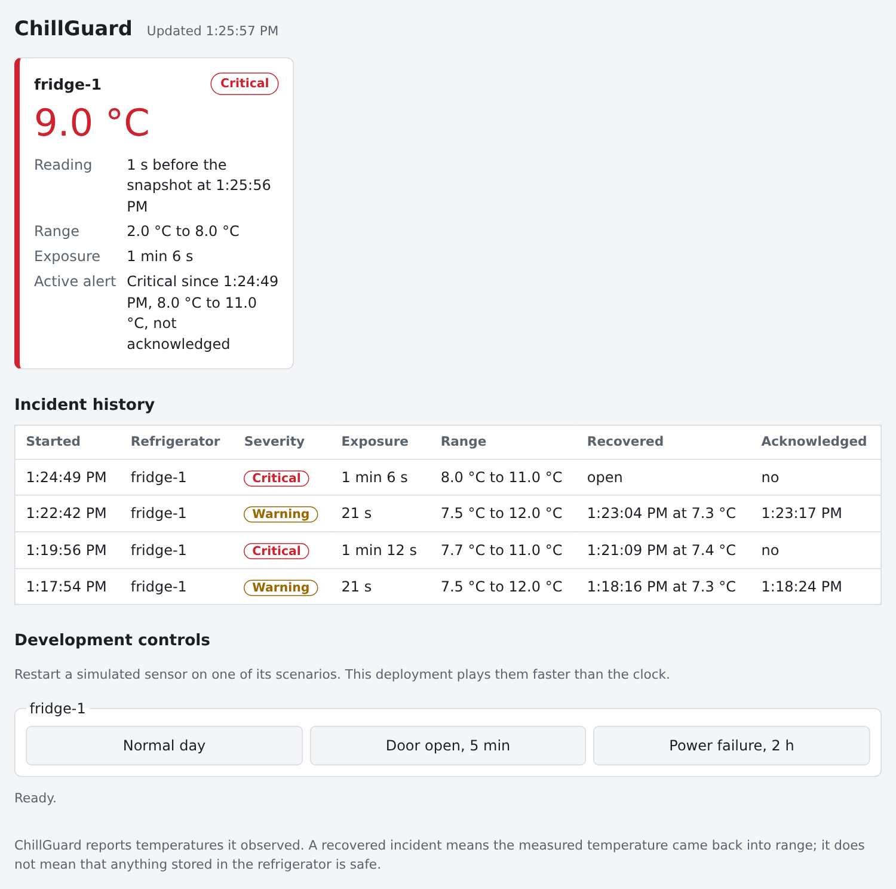

# ChillGuard playground

One command puts a simulated refrigerator on your machine, has ChillGuard
watch it, and opens a dashboard in your browser. You press a button, the
power "fails", and you see what ChillGuard does about it. Another command
removes everything again.

```sh
make start      # from the repository root
```

| I want to... | Go to |
|---|---|
| get it running | [1. Start it](#1-start-it) |
| know what I am looking at | [2. The dashboard](#2-the-dashboard) |
| make something happen | [3. Things to try](#3-things-to-try) |
| use the command line as well | [4. The same refrigerator from a terminal](#4-the-same-refrigerator-from-a-terminal) |
| end it, or begin again | [5. Stop and start over](#5-stop-and-start-over) |
| use another port, or no browser | [6. Options](#6-options) |
| fix a problem | [7. If something goes wrong](#7-if-something-goes-wrong) |
| know what this is not | [8. What the playground is, and is not](#8-what-the-playground-is-and-is-not) |

## 1. Start it

You need what the main README lists under
[Prerequisites](../../README.md#prerequisites): Linux x86_64, `rustup`, a C
toolchain and the Myrmic CLI 0.7.0. Then, in the repository:

```sh
make start
```

The first time this builds the cells and the `chillguard` program, which
takes a few minutes. After that it takes about ten seconds:

```text
starting runtime chillguard-play...
deploying sensor-cell...
deploying fridge-asset-cell...
deploying risk-monitor-cell...
deploying dashboard-cell...
waiting for the dashboard...
The ChillGuard playground is running.

  dashboard  http://localhost:8642/chillguard/
  runtime    chillguard-play (in memory: nothing is kept once it stops)
  endpoint   tcp/127.0.0.1:20124
```

Your browser opens on <http://localhost:8642/chillguard/>. If none opens
(you are on a remote machine, say), open that address yourself.

`make start` is `make build-cells cli` followed by `chillguard start`. Once
everything is built you can use the program directly:

```sh
export PATH="$PWD/target/debug:$PATH"
chillguard start
```

Running `start` again while the playground is up does no harm: it prints
the address again and reopens the page.

## 2. The dashboard



| Part of the page | What it tells you |
|---|---|
| **Updated ...** beside the title | When the page last fetched fresh data. It turns red and says `Not updating` if it cannot. |
| **The card** | One refrigerator, `fridge-1`. The big number is its latest temperature; the badge is its status: `Normal`, `Warning`, `Critical` or `Sensor stale`. |
| Reading | How old the reading was when the snapshot was taken. |
| Range | The safe range: 2.0 to 8.0 °C here. |
| Exposure | How long the refrigerator has been out of range in the incident that is open now. `none` when all is well. |
| Active alert | The open incident: how serious, since when, the temperatures seen, and whether somebody has acknowledged it. |
| **Incident history** | Every incident so far, newest first. An incident that says `open` under Recovered is still going on. On a narrow window each incident is a block instead of a table row. |
| **Development controls** | Three buttons that make the simulated refrigerator do something. This is where you play. |

The page refreshes itself every two seconds. Nothing needs reloading.

## 3. Things to try

The playground's clock runs **sixty times faster** than a real one: a
simulated minute passes every second, so a two-hour power failure takes two
minutes. An incident turns critical after **one minute** out of range (real
time), and the sensor counts as stale after **30 seconds** of silence.

Each button restarts the simulated refrigerator at the beginning of that
scenario. The times below were measured from the press.

| Press | What you see | When |
|---|---|---|
| **Door open, 5 min** | The temperature jumps to 12 °C: the badge turns `Warning`, an incident appears in the history, Exposure starts counting. The door closes, the cabinet cools, and the card goes back to `Normal`; the incident stays in the history as a recovered warning. It never turns critical: it is over too soon. | Warning after about 10 s, normal again about 20 s later |
| **Power failure, 2 h** | Half a minute of nothing, then the temperature creeps up. Above 8 °C the badge turns `Warning`. A minute later it turns `Critical` and the incident's severity changes with it. When the power returns the cabinet cools and the card goes back to `Normal`; the incident is closed and keeps `Critical`. | Warning after about 1 min 30 s, critical at 2 min 30 s, normal at about 2 min 45 s |
| **Normal day** | Nothing: the temperature stays near 4 °C. Use it to cancel a scenario that is playing. | at once |

Two more, from a terminal (section 4 sets it up):

| Do | What you see | When |
|---|---|---|
| Tighten the limit: `chillguard set-limits --upper 3.5` | The refrigerator is at 4 °C, which is now too warm: `Warning`, and `Critical` a minute later if you leave it. `chillguard set-limits --upper 8` ends it. The Range on the card follows. | within a couple of seconds |
| Take the sensor away: `myrmic --connect tcp/127.0.0.1:20124 delete sensor-cell --cell` | The temperature stops changing, and then the badge turns `Sensor stale`: ChillGuard says it no longer knows, rather than showing the last value as if it were current. `chillguard start` puts the sensor back. | stale after 30 to 45 s |

A recovered incident means the *measured* temperature came back into range.
It does not mean that what was in the refrigerator is still good.

## 4. The same refrigerator from a terminal

The dashboard only shows. The `chillguard` program can also change things.
Tell it where the playground is, once per terminal:

```sh
export PATH="$PWD/target/debug:$PATH"            # if you have not already
export MYRMIC_CONNECT=tcp/127.0.0.1:20124
```

| Command | What it does |
|---|---|
| `chillguard status` | The card, as text: status, last reading, limits, open incident. |
| `chillguard watch` | Prints every status change, alert and recovery as it happens. Leave it running in a second terminal while you press buttons. Ctrl-C stops it. |
| `chillguard incidents` | The incident history, with each incident's id. |
| `chillguard ack <incident id>` | Records that you have seen an incident. The page's Acknowledged column shows the time. |
| `chillguard set-limits --upper 6` | Changes the safe range (also `--lower`, `--critical-after 30s`, `--stale-after 1m`, `--hysteresis 0.2`). |
| `chillguard simulate power_failure_2h` | What the buttons do: also `short_door_open` and `normal_day`. |

Add `--json` to any of them for JSON, and `--help` for everything else.

A session, as it ran on 2026-10-12:

```text
$ chillguard simulate short_door_open
sent scenario short_door_open (seed 0) to sensor-cell
The sensor only plays it when its dev_mode is on, and does not answer; its log says `scenario started` or `simulate_scenario rejected`.
$ chillguard watch --for 45s
watching fridge-1: status normal, last reading 3.9 °C, limits 2.0 to 8.0 °C, hysteresis 0.5 °C (Ctrl-C to stop)
2026-10-12T13:22:42Z  ALERT      warning   fridge-1-1791811362114  out of range at 12.0 °C
2026-10-12T13:22:42Z  status     normal -> warning
2026-10-12T13:23:04Z  status     warning -> normal
2026-10-12T13:23:04Z  recovered  fridge-1-1791811362114  was warning, out of range for 21s, now 7.3 °C
$ chillguard ack fridge-1-1791811362114
incident fridge-1-1791811362114 acknowledged at 2026-10-12T13:23:17Z
```

## 5. Stop and start over

```sh
make stop       # or: chillguard stop
```

That stops the playground's runtime. Everything it held was in memory, so
the refrigerator, its limits and its incidents are gone, and the next
`make start` begins with a new refrigerator at 4 °C and an empty history.

The playground also ends when the machine reboots. It does not end when you
close the browser tab or the terminal.

## 6. Options

`chillguard start` takes these; `make start` runs it without any.

| Option | Default | For |
|---|---|---|
| `--port <PORT>` | `8642` | Serving the dashboard on another port, when 8642 is taken. |
| `--no-open` | off | Not opening a browser: the address is only printed. |
| `--cells <DIR>` | `target/wasm32-unknown-unknown/release` | Using cells built somewhere else. |
| `--swarm-port <PORT>` | `20124` | Moving the runtime's own port, the one `MYRMIC_CONNECT` names. |
| `--name <NAME>` | `chillguard-play` | Running a second playground. Stop it with `chillguard stop --name <NAME>`, and give it its own two ports. |
| `--json` | off | The address and the endpoint as JSON, for scripts. |

To look at the dashboard from a phone on the same network, open
`http://<this machine's address>:8642/chillguard/` on it.

## 7. If something goes wrong

| You see | It means | Do |
|---|---|---|
| `the built cells were not found in ...` | The cells have not been built here. | `make start`, or `make build-cells` and then `chillguard start`. |
| ``cannot run `myrmic` ...`` | The Myrmic CLI is not installed or not on the `PATH`. | Install it: [Prerequisites](../../README.md#prerequisites). |
| `port 8642 is in use on this machine` | Something else listens there. | `chillguard start --port 8650` |
| `the playground is already running with its dashboard on port ...` | You asked for other ports than the running playground has. | `chillguard stop`, then start with the ports you want. |
| `could not deploy ...: ... failed to deserialize json` | The cells were built from older sources than the program. | `make start` (it rebuilds). |
| The page says `myrmic gateway: no application is mounted at this path` | The playground lost its cells. This happens when the computer has been asleep. | `chillguard start` again. It puts them back; the incidents so far are still there. |
| A card says `No answer` | One of the cells is not answering. | `chillguard start` again. |
| `Not updating` beside the title | The page cannot reach the playground: it was stopped, or the machine restarted. | `make start` |
| A button says `Sent ...` and nothing changes | Give it time: a power failure shows nothing for a minute and a half. | Wait, or press **Door open, 5 min** for something quick. |
| `chillguard status` says `... is not deployed on a runtime this client can reach` | The terminal does not know where the playground is, or a prefix is set. | `export MYRMIC_CONNECT=tcp/127.0.0.1:20124`, and `unset CHILLGUARD_PREFIX`. |
| No browser opened | There is no desktop to open one on. | Open the printed address yourself. |

What the runtime and the cells logged:

```sh
myrmic runtimes chillguard-play logs | grep wasm_log
```

## 8. What the playground is, and is not

- **It is a simulation.** There is no refrigerator and no sensor: a model
  produces the temperatures. ChillGuard itself is the real thing, the same
  cells and the same rules a deployment runs, with the development settings
  (the fast clock, short durations, the scenario buttons).
- **It keeps nothing.** Its runtime holds everything in memory and never
  touches the network of other Myrmic runtimes. `stop` leaves nothing
  behind but the Myrmic runtime's own name record and log file under
  `~/.local/share/myrmic`.
- **Its dashboard is not private.** The port it is served on can be reached
  from other machines on your network, there is no login, and the scenario
  buttons work for whoever opens the page. All anyone can reach that way is
  the playground's simulated refrigerator. Stop it when you are done, and
  do not run it on a network where that would matter.
- **It is not how you run ChillGuard for real.** For a deployment that
  keeps its state, uses real time and refuses the development commands, see
  [Run](../../README.md#run) in the main README, and
  [docs/security.md](../security.md) before you put a dashboard on a
  network.
- **It says what it measured, not what is safe.** ChillGuard reports
  temperatures and how long they were out of range. Whether food or
  medicine is still good is not something it can tell you.
